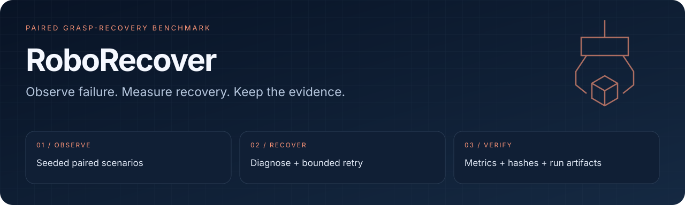

<div align="center">
  
  <h1>RoboRecover</h1>
  <p><strong>用可复现的成对实验，衡量机器人抓取失败后的恢复能力。</strong></p>
  <p><a href="https://github.com/eust-w/amdcompetition/actions/workflows/ci.yml"></a>
  
  
  </p>
  <p>
    <a href="#overview">项目亮点</a> ·
    <a href="#quick-start">快速开始</a> ·
    <a href="#workflow">工作流</a> ·
    <a href="#validation">验证与边界</a> ·
    <a href="#documentation">文档</a>
  </p>
  <p><a href="README.md">English</a> · <a href="README.zh-CN.md">简体中文</a></p>
</div>

---

<a id="overview"></a>
## 衡量抓取，也衡量失败后的恢复

**RoboRecover** 在相同随机种子的场景上，对比原始基线控制器与 **观察 → 抓取 → 验证 → 诊断 → 重试** 控制器。每次运行产出 episode 记录、汇总指标和内容哈希，便于复核与复现。

| 成对实验 | 有界恢复 | 可检查证据 |
| :--- | :--- | :--- |
| 基线与恢复策略使用相同场景 | 空抓、滑落、位姿偏移；默认至多重试一次 | JSONL、指标报告、manifest 与本地评测台 |

> [!IMPORTANT]
> `analytic` 是确定性的指标校准和 CI 路径，不代表真实物理抓取或 ROCm 执行。硬件结论必须由对应后端及验收产物支持。

<a id="quick-start"></a>
## 快速开始

使用 **Python 3.10–3.13**。可选 Dashboard 需要 Node.js，CI 使用 Node.js 22。

```bash
git clone https://github.com/eust-w/amdcompetition.git
cd amdcompetition
python3 -m venv .venv
source .venv/bin/activate
python -m pip install -e '.[test]'
roborecover evaluate --backend analytic
```

### 打开本地评测台

```bash
npm --prefix dashboard ci
npm --prefix dashboard run build
roborecover serve --backend analytic
```

访问 **<http://127.0.0.1:8787>**。界面读取实际 run 产物，并通过本地 API 启动评测；显示 analytic 结果不意味着通过了物理验收。

<a id="workflow"></a>
## 从失败到可比较的结果

```text
同一 seeded scenario ─┬─ 基线控制器 ────────────────────┐
                      └─ 抓取 → 验证 → 诊断 → 重试 ────┤
                                                       ▼
                                             成对记录 + 汇总指标
                                                       ▼
                                             内容哈希 + 复现比较
```

| 后端 | 用途 | 能证明什么 |
| :--- | :--- | :--- |
| `analytic` | 快速校准与 CI | 恢复逻辑、指标和产物生成 |
| `genesis-cpu` | 物理 smoke | CPU 上 Genesis Franka/cube 流程 |
| `genesis-rocm` | Radeon 验收 | 通过严格运行时检查后的 `gs.amdgpu` 物理执行 |

严格 ROCm 检查包含 Linux、HIP PyTorch、`/dev/kfd` 和单个可见 GPU。单元测试或界面截图不能替代这些证据。

<a id="validation"></a>
## 两次运行的复现比较

```bash
python -m pytest
roborecover evaluate --backend analytic --output runs/repro-a
roborecover evaluate --backend analytic --output runs/repro-b
LEFT="runs/repro-a/$(cat runs/repro-a/LATEST)/report.json"
RIGHT="runs/repro-b/$(cat runs/repro-b/LATEST)/report.json"
roborecover verify-repro --left "$LEFT" --right "$RIGHT" --tolerance 0
```

默认 analytic 配置包含 **400 个成对 episode**。这些数字用于基准校准，不能作为物理成功率宣传。

<details>
<summary><strong>Radeon / ROCm 验收命令</strong></summary>

在具备相应设备和 Docker 的 Linux Radeon 主机上：

```bash
docker build -f docker/Dockerfile.rocm -t roborecover:rocm .
docker run --rm \
  --device=/dev/kfd --device=/dev/dri --group-add=video \
  --ipc=host --security-opt seccomp=unconfined \
  -v "$PWD/runs:/workspace/runs" \
  roborecover:rocm check-rocm

docker run --rm \
  --device=/dev/kfd --device=/dev/dri --group-add=video \
  --ipc=host --security-opt seccomp=unconfined \
  -v "$PWD/runs:/workspace/runs" \
  --entrypoint bash roborecover:rocm scripts/acceptance_rocm.sh
```

两份报告都必须声明 `rocm_verified: true`，且差异在配置容差内。详见 [ROCm 验收](docs/rocm-acceptance.md)。

</details>

每次运行保留 `config.json`、`episodes.jsonl`、`manifest.json`、`report.json` 和 `summary.md`；比较步骤另生成复现证书。报告区分后端，manifest 保存文件尺寸与 SHA-256。

<a id="documentation"></a>
## 文档导航

| 入口 | 内容 |
| :--- | :--- |
| [架构](docs/architecture.md) | 场景、控制器、runner 与产物 |
| [Dashboard 设计](docs/dashboard-design.md) | 评测台 |
| [赛事报告](docs/competition-report.md) | 提交背景与证据 |
| [ROCm 验收](docs/rocm-acceptance.md) | 环境检查与双次运行 |
| [第三方说明](THIRD_PARTY_NOTICES.md) | Genesis 与依赖来源 |

## 许可证

原创代码采用 [Apache-2.0](LICENSE)。Genesis 由 ROCm 容器配方按固定版本安装；容器中各组件保留上游许可，详见 [第三方说明](THIRD_PARTY_NOTICES.md)。
