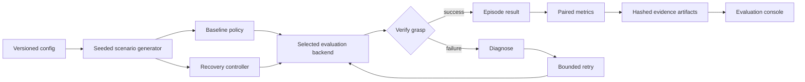

# Architecture

## Closed loop

The baseline and recovery branches are reset to the same `Scenario`. Their first-attempt records must be identical; a unit test enforces that invariant. Only the recovery branch may diagnose and retry.

## Components

- `config.py`: validates the benchmark schema and seed set.
- `scenarios.py`: creates deterministic fault parameters without global RNG state.
- `policy.py`: owns detection, diagnosis and the bounded retry controller.
- `backends/analytic.py`: calibrated deterministic surrogate for CI only.
- `backends/genesis_backend.py`: physical Franka/cube control with CPU and strict `gs.amdgpu` modes.
- `metrics.py`: paired success, detection, recovery, retry and failure-taxonomy metrics.
- `artifacts.py`: canonical serialization, content digests, provenance and manifests.
- `server.py`: same-origin read/run/download API and static dashboard hosting.
- `dashboard/`: responsive React console consuming only `/api/latest` artifacts.

## Claim boundaries

The analytic backend never imports Genesis and is intentionally fast enough for CI. It proves orchestration and reproducibility, not robot physics.

The physical backend performs a real sequence for each policy branch:

1. Reset Franka and cube to the seeded scenario.
2. Observe cube state and apply the seeded position/pose error.
3. Approach, close the gripper and lift.
4. Verify using measured cube height.
5. Diagnose a miss, pose error or slip.
6. Correct target pose or grip force and retry once.

`genesis-rocm` additionally refuses to initialize unless the HIP/Radeon preflight succeeds.

